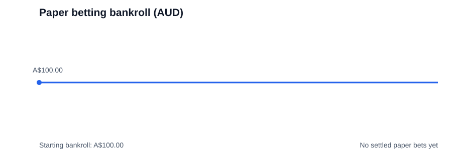

### AI prediction baseline — awaiting first verified run

[Generate NBA AI predictions](.github/workflows/generate-nba-predictions.yml) uses a separately trained ESPN rolling-feature logistic-regression baseline, not the legacy 106-feature XGBoost model. It builds features from earlier completed games, trains on chronological historical examples, predicts scheduled future games, and commits timestamped predictions to [research/live_predictions](research/live_predictions). It is configured for daily runs at 15:00 UTC and manual dispatch. **No live successful prediction has been verified yet.** A run may fail if ESPN blocks requests, if insufficient games are returned, or if no future games are available. Predictions are research-only; no odds-based paper bets or settlements are generated by this workflow.

### Unattended 90-day research archive (Nov 4, 2026 – Feb 1, 2027 UTC)

The [daily GitHub Actions archive](.github/workflows/nba-paper-week.yml) is configured to request HaterPicks NBA odds once daily and commit raw snapshots to [research/odds_snapshots](research/odds_snapshots) while the experiment window is active. This preserves snapshots in Git history, subject to GitHub Actions availability, API limits, repository permissions, and service reliability.

**Current automation scope:** odds collection only. It does **not** yet run verified pregame predictions, place paper bets, settle results, retrain models, promote candidates, or guarantee bankroll growth. No real bets will be placed. The permanent prediction event log remains empty until a genuine model pipeline writes records. Do not interpret the flat A$100 chart as trading performance.

### Permanent prediction research history

[Append-only prediction and settlement records](research/events.jsonl) · [Research log and training rules](research/README.md)

All future model predictions should be logged before tipoff, including no-bet decisions, then settled as separate events. **The historical event log is currently empty:** automatic prediction generation, settlement, and model retraining have not been connected yet. Existing odds snapshots are not predictions.

## NBA Money Printer — seven-day paper betting (A$100 virtual bankroll)



**Status:** Odds snapshots are configured; prediction-to-odds matching and automated paper-bet settlement are not yet implemented. The graph starts at A$100 and changes only when genuine settled bets are added to [the ledger](paper_betting/ledger.csv). **No betting performance is claimed yet.**

- [Paper betting ledger and chart instructions](paper_betting/README.md)
- [Daily odds snapshot workflow](.github/workflows/nba-paper-week.yml)
- [Chart refresh workflow](.github/workflows/update-paper-chart.yml)

---

# NBA Sports Betting Using Machine Learning


## Overview
This project predicts NBA game winners and totals (over/under) using team stats and sportsbook odds. It pulls team data from 2007-08 through the current season, builds matchup features, and runs trained models to estimate win probabilities and totals outcomes. It also outputs expected value and optional Kelly Criterion stake sizing.

## Features
- Moneyline and totals predictions (XGBoost and Neural Net models).
- Expected value calculation and optional Kelly Criterion sizing.
- Odds ingest from supported sportsbooks or manual input.
- Data processing pipeline and model training scripts.
- Flask web app for browsing outputs.

## How it works
1. **Collect stats and odds**: `Get_Data` pulls daily team stats from NBA endpoints and stores them in SQLite. `Get_Odds_Data` pulls sportsbook odds and scores from SBR and stores them in a separate SQLite DB.
2. **Build game features**: `Create_Games` merges team stats, odds, scores, and days-rest into a training dataset.
3. **Train models**: XGBoost/NN scripts in `src/Train-Models` fit moneyline and totals models.
4. **Predict today**: `main.py` fetches today’s schedule, builds matchup features, loads trained models, and prints predictions, expected value, and optional Kelly Criterion sizing.

## Requirements
- Python 3.11
- Packages: Tensorflow, XGBoost, NumPy, Pandas, Colorama, Tqdm, Requests, Scikit-learn

Install dependencies:
```bash
pip3 install -r requirements.txt
```

## Quick start
```bash
python3 main.py -xgb -odds=fanduel
```

Odds will be fetched automatically when `-odds` is provided. Supported books:
`fanduel`, `draftkings`, `betmgm`, `pointsbet`, `caesars`, `wynn`, `bet_rivers_ny`

If `-odds` is omitted, the script will prompt for manual odds and totals.

Optional flags:
- `-nn` run neural network model
- `-xgb` run XGBoost model
- `-A` run all models
- `-kc` show Kelly Criterion bankroll fraction

## Flask web app


```bash
cd Flask
flask --debug run
```

## Data pipeline and training
```bash
# Create/update datasets
cd src/Process-Data
python -m Get_Data
python -m Get_Odds_Data
python -m Create_Games

# Train models
cd ../Train-Models
python -m XGBoost_Model_ML --dataset dataset_2012-26 --trials 100 --splits 5 --calibration sigmoid
python -m XGBoost_Model_UO --dataset dataset_2012-26 --trials 100 --splits 5 --calibration sigmoid
python -m NN_Model_ML
python -m NN_Model_UO
python -m Logistic_Regression_ML --dataset dataset_2012-26_new --trials 50 --splits 5 --calibration sigmoid
python -m Logistic_Regression_UO --dataset dataset_2012-26_new --trials 50 --splits 5 --calibration sigmoid
```

### Neural network notes
- The current NN training scripts are the original versions with hard-coded dataset and model paths.
- They train on `dataset_2012-24_new` and save into `Models/` with timestamped names.
- If you want configurable flags or feature/scaler sidecars, switch back to the newer NN scripts.

### Backfilling missing data
Get_Data normally fetches only new dates in the current season. To fill missing dates:
```bash
cd src/Process-Data
python -m Get_Data --backfill
```

To backfill a single season:
```bash
cd src/Process-Data
python -m Get_Data --backfill --season 2025-26
```

### Backfilling odds data
Get_Odds_Data normally fetches only new dates in the current season. To fill missing odds dates:
```bash
cd src/Process-Data
python -m Get_Odds_Data --backfill
```

To backfill a single season:
```bash
cd src/Process-Data
python -m Get_Odds_Data --backfill --season 2025-26
```

## Contributing
Contributions are welcome. If you change model behavior or data pipelines, add a note in the README and update any related scripts or docs.
